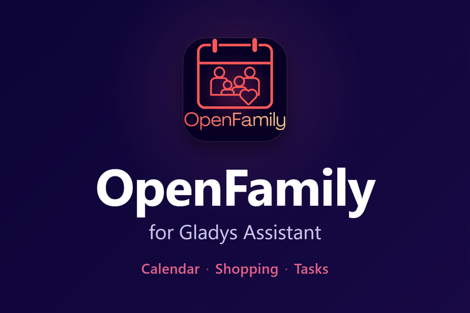
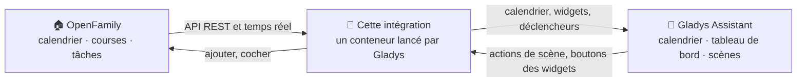

  
  <h1>OpenFamily pour Gladys Assistant</h1>
  
<strong>Le calendrier familial, la liste de courses et les tâches, directement dans votre domotique</strong> 
  Deux projets open source français, tous deux hébergés à la maison.

🇬🇧 <a href="README.md">English</a> · 🇫🇷 <strong>Français</strong>

---

[OpenFamily](https://github.com/NexaFlowFrance/OpenFamily) est un organisateur familial libre et
auto-hébergé : calendrier, liste de courses, tâches, repas, budget.
[Gladys Assistant](https://gladysassistant.com) est un assistant domotique open source,
respectueux de la vie privée. Cette intégration relie les deux : Gladys s'occupe de la maison,
OpenFamily de la vie de famille qui s'y déroule.

## ✨ Ce que vous obtenez

|                                      |                                                                                                                                              |
| ------------------------------------ | -------------------------------------------------------------------------------------------------------------------------------------------- |
| 📅 **Calendrier familial**           | Le calendrier d'OpenFamily comme calendrier Gladys, tenu à jour : récurrences et journées entières, un mois d'historique, douze mois à venir |
| 🧩 **Widgets**                       | Les rendez-vous du jour, la liste de courses et les tâches, avec des boutons pour ajouter et pour cocher                                     |
| 🎬 **Actions de scène**              | Ajouter à la liste de courses, ajouter une tâche, lire la liste de courses, lire les tâches                                                  |
| ⚡ **Déclencheurs de scène**         | Article ajouté à la liste, tâche terminée, tâche à faire aujourd'hui                                                                         |
| 🔔 **Rappels**                       | Avec le déclencheur natif de Gladys « un événement du calendrier approche », sur le calendrier OpenFamily partagé                            |
| 🔄 **Temps réel**                    | Un changement fait dans OpenFamily arrive dans Gladys en quelques secondes                                                                   |
| 🔐 **Vos données restent chez vous** | L'intégration ne parle qu'à votre Gladys et à votre serveur OpenFamily. Gladys ne modifie jamais votre calendrier                            |

## 💡 Des idées de scènes

- 🌅 Au réveil de la famille, lire les tâches du jour et les annoncer sur une enceinte.
- 🧈 Un bouton sur le frigo qui ajoute du beurre à la liste de courses.
- 🛒 Un message à la personne qui fait les courses quand un article est ajouté à la liste.
- 🦷 La lumière de l'entrée s'allume un quart d'heure avant le rendez-vous chez le dentiste.
- ✅ Un mot de félicitations quand quelqu'un termine une tâche.

## 🚀 Installation en trois étapes

1. **Dans OpenFamily**, ouvrez **Paramètres**, puis **Jetons d'API**, créez un jeton **Lecture
   et écriture** et copiez-le. Il n'est affiché qu'une fois.
2. **Dans Gladys** (5.2.0 ou plus récent), ouvrez **Intégrations**, cherchez **OpenFamily** dans
   le catalogue et installez-la.
3. **Configurez-la** : l'adresse de votre serveur OpenFamily, le jeton, puis **Tester la
   connexion**.

Activez ensuite le calendrier dans **Mes calendriers** et ajoutez les widgets à votre tableau de
bord.

📖 Guide complet et dépannage : [Français](docs/fr.md) · [English](docs/en.md)

## 🔧 Comment ça marche

L'intégration tourne dans son propre conteneur isolé, lancé par Gladys. Elle lit l'API REST
d'OpenFamily avec un jeton d'API personnel, régulièrement et dès que le canal temps réel
d'OpenFamily signale un changement. Gladys conserve le jeton comme un secret, et il n'est envoyé
qu'à votre serveur OpenFamily.

## 🧰 Pour les développeurs

La structure du code, les commandes et la procédure de release sont décrites dans le
[README en anglais](README.md#-for-developers).

## 🤝 Vos retours

Un problème, une idée ? Ouvrez une
[issue](https://github.com/NexaFlowFrance/gladys-openfamily/issues), ou venez en parler sur le
[forum de la communauté Gladys](https://community.gladysassistant.com).

## 🙏 Crédits

Construite à partir du
[template JavaScript](https://github.com/GladysAssistant/integration-template-js) et du
[SDK](https://github.com/GladysAssistant/integration-sdk-js) officiels de Gladys Assistant, en
suivant les conseils donnés sur le forum de la communauté Gladys. C'est l'intégration du projet
OpenFamily ; elle ne fait pas partie de Gladys Assistant.

## 📄 Licence

Apache-2.0, voir [LICENSE](LICENSE).
