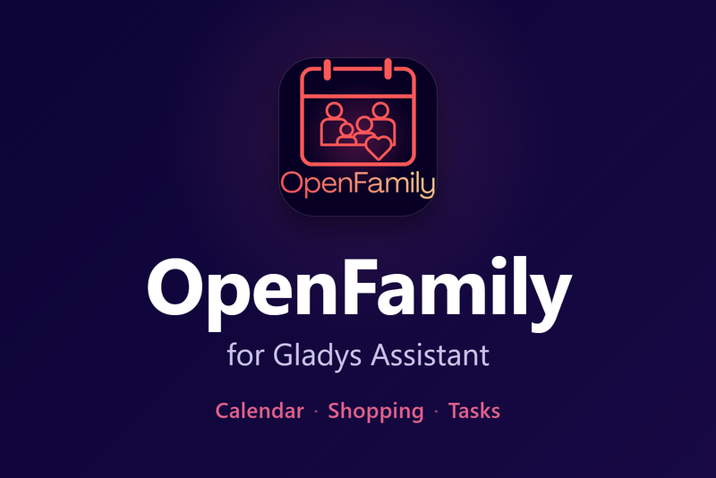
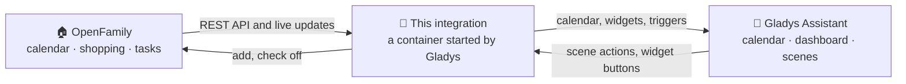

<div align="center">
  
  <h1>OpenFamily for Gladys Assistant</h1>
  <p><strong>The family calendar, shopping list and tasks, right in your home assistant</strong><br>
  Two open-source projects made in France, both running at home.</p>

🇬🇧 <strong>English</strong> · 🇫🇷 <a href="README.fr.md">Français</a>

[](https://nexaflow.fr)
[](https://github.com/NexaFlowFrance/gladys-openfamily/releases/latest)
[](https://github.com/NexaFlowFrance/gladys-openfamily/actions/workflows/ci.yml)
[](https://gladysassistant.com)
[](https://github.com/NexaFlowFrance/gladys-openfamily/pkgs/container/gladys-openfamily)
[](LICENSE)

</div>

---

[OpenFamily](https://github.com/NexaFlowFrance/OpenFamily) is a free, self-hosted family
organizer: calendar, shopping list, tasks, meals, budget.
[Gladys Assistant](https://gladysassistant.com) is an open-source home assistant that respects
your privacy. This integration connects the two: Gladys looks after the house, OpenFamily after
the family life that happens in it.

This is the official OpenFamily integration for Gladys Assistant, built and maintained by
[NexaFlow](https://nexaflow.fr), the team behind OpenFamily.

## ✨ What you get

|                           |                                                                                                                             |
| ------------------------- | --------------------------------------------------------------------------------------------------------------------------- |
| 📅 **Family calendar**    | The OpenFamily calendar as a Gladys calendar, kept up to date: recurring and full-day events, one month back, twelve ahead  |
| 🧩 **Dashboard widgets**  | Today's appointments, the shopping list, the tasks and the meals, with buttons to add an entry and to check one off         |
| 🎬 **Scene actions**      | Add to the shopping list, add a task, read the shopping list, read the tasks, read the menu                                 |
| ⚡ **Scene triggers**     | Item added to the shopping list, task completed, task due today                                                             |
| 👧 **One list per child** | The tasks widget can show a single family member's tasks, and the task triggers say who a task is assigned to               |
| 🔔 **Reminders**          | With Gladys' own trigger "an event of the calendar is coming", on the shared OpenFamily calendar                            |
| 🔄 **Live updates**       | A change made in OpenFamily reaches Gladys within seconds                                                                   |
| 🔐 **Private by design**  | The integration talks to your Gladys and to your OpenFamily server, and to nothing else. Gladys never changes your calendar |

## 💡 Ideas for scenes

- 🌅 When the family wakes up, read today's tasks and announce them on a speaker.
- 🧈 A button on the fridge that adds butter to the shopping list.
- 🍽️ At six in the evening, announce tonight's dinner on the kitchen speaker.
- 🧒 On the tablet in each child's room, their own list of tasks.
- 🛒 A message to whoever is at the shop when an item is added to the list.
- 🦷 The hallway light turns on fifteen minutes before the dentist appointment.
- ✅ A word of congratulations when someone completes a task.

## 🚀 Install in three steps

1. **In OpenFamily** (2.0 or later), open **Settings**, then **API tokens**, create a **Read and
   write** token and copy it. It is shown only once.
2. **In Gladys** (5.2.0 or later), open **Integrations**, find **OpenFamily** in the catalog and
   install it.
3. **Configure it**: the address of your OpenFamily server, the token, then **Test the
   connection**.

Then enable the calendar in **My calendars** and add the widgets to your dashboard.

📖 Full guide and troubleshooting: [English](docs/en.md) · [Français](docs/fr.md)

## 🔧 How it works



The integration runs in its own sandboxed container, started by Gladys. It reads OpenFamily's
REST API with a personal API token, periodically and as soon as OpenFamily's real-time channel
reports a change. Gladys stores the token as a secret, and it is sent to your OpenFamily server
only.

## 🧰 For developers

```
index.js            SDK wiring only
src/app.js          reading loop, calendar mirroring, widget, scene and action handlers
src/openfamily.js   the OpenFamily REST client
src/live.js         OpenFamily's real-time channel (WebSocket)
src/calendar.js     appointments to Gladys events, sync windows
src/widgets.js      the contents of the widgets
src/family.js       family members: who a first name stands for, who a task is for
src/meals.js        the meal plan, in the order of the day
src/config.js       configuration defaults and normalization
src/state.js        what is remembered through a restart, kept in /data
src/i18n.js         every text, in English and French
test/               node --test, against the SDK's fake Gladys and an in-memory OpenFamily
```

```bash
npm install
npm test               # unit tests, no network
npm run lint
npm run format:check
npx github:GladysAssistant/integration-store .   # the store's admission checks
```

To run it against a real Gladys outside Docker:

```bash
GLADYS_HOST_API_URL="http://localhost:1443" \
GLADYS_INTEGRATION_TOKEN="<token>" \
GLADYS_INTEGRATION_SELECTOR="openfamily" \
LOG_LEVEL=debug \
npm start
```

Releases go through **Actions**, then **Release**: the workflow bumps the version in
`package.json` and in the manifest, rolls the changelog, tags, and builds the `linux/amd64` and
`linux/arm64` image.

## 🤝 Feedback

A problem or an idea? Open an [issue](https://github.com/NexaFlowFrance/gladys-openfamily/issues),
or come and talk about it on the [Gladys community forum](https://community.gladysassistant.com).

## 🙏 Credits

Built on the official
[JavaScript integration template](https://github.com/GladysAssistant/integration-template-js) and
[SDK](https://github.com/GladysAssistant/integration-sdk-js) of Gladys Assistant, following the
guidance given on the Gladys community forum. This is the official integration of the OpenFamily
project, maintained by [NexaFlow](https://nexaflow.fr). It is not part of Gladys Assistant, where
it is listed as a community integration.

## 📄 License

Apache-2.0, see [LICENSE](LICENSE).
